# PSTAL - Prédiction Structurée pour le Traitement Automatique des Langues

Pedagogical materials for the 2024-2025 version of the advanced NLP course
of Master 2 in AI and ML, Aix Marseille University and Centrale Marseille.

# Installation

Before compiling the report, you need to set up a Python environment and install the necessary dependencies.
```shell
conda create --name pstal python=3.12
```

```shell
conda activate pstal
```

```shell
pip install -r requirements.txt
```

# TP1: POS Labelling using Reccurent Neural Network
n this task, each word is assigned a part-of-speech (POS) tag, indicating its grammatical role in the sentence. <br>
For example, the word été is a noun (tagged as NOUN) in l’été arrive. <br>
This is a sequence labeling task because, for every input sentence w1,w2,…,wn, <br>
the goal is to predict a sequence of tags t1,t2,…,tn of the same length. <br>
The challenges of this task include: (1) some words are ambiguous (2) the context, i.e., the surrounding words, <br>
plays a crucial role in disambiguating words with multiple possible POS tags; and (3) <br>
the system must be able to predict POS tags for words not observed in the training corpus, often referred to as "OOV" (out-of-vocabulary)
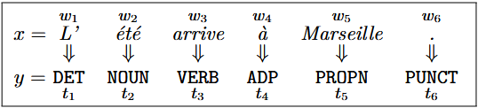 <br>

First let's run learn model using neural network using these parametters:

    batch_size = 64
    nb_epochs = 120
    max_len = 30
    embedding_size = 100
    hidden_layer = 32
You can update them in this file ``pstal/tp1/sequoia/bin/main.py``.

```shell
python pstal/tp1/sequoia/bin/demo_with_extension.py
```

You will have this kind of result:

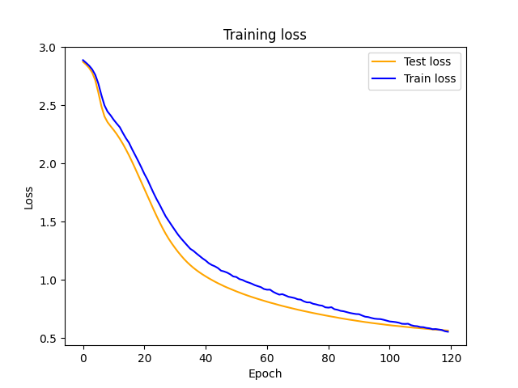

Then compute evaluation score:
```shell
python pstal/tp1/sequoia/bin/accuracy.py --pred pstal/tp1/sequoia/bin/predictions.conllu --gold pstal/tp1/sequoia/sequoia-ud.parseme.frsemcor.simple.test --tagcolumn upos
```
We obtain this score: 84.36 ( 8097/ 9598).

# TP2: Named entity recognition with HMMs

The goal of this lab is to develop and evaluate a named entity recognition system using a Hidden Markov Model (HMM). <br>
This is a probabilistic system, not a neural network. Parameter estimation is based on counts from the corpus,  <br>
without iterative learning through backpropagation. <br>
Therefore, we will not be using the PyTorch library this time. <br>

1. Start training
```shell
python pstal/tp2/train_ner.py lib/corpus/sequoia-ud.parseme.frsemcor.simple.train pstal/tp2/train_ner.parameters.pkl
```

2. Compute prediction
```shell
python pstal/tp2/predict_ner.py pstal/tp2/train_ner.parameters.pkl lib/corpus/sequoia-ud.parseme.frsemcor.simple.test pstal/tp1/predictions.test.conllu
```

3. Compute evaluation
```shell
git clone https://gitlab.com/parseme/cuptlib.git
```
```shell
cd cuptlib | pip install . 
```
Then back to pstal folder 
```shell
cd ..
```

```shell
python lib/accuracy.py --pred pstal/tp2/predictions.test.conllu --gold lib/corpus/sequoia-ud.parseme.frsemcor.simple.test --tagcolumn parseme:ne
```

The first result obtained is :
```shell
Predictions file: pstal/tp2/predictions.test.conllu
Accuracy on all parseme:ne: 89.22 ( 8563/ 9598)

Precision, recall, and F-score for parseme:ne:
Exact-EVE  : P= 40.74 (   11/   27) / R= 55.00 (   11/   20) / F= 46.81
Exact-LOC  : P= 76.92 (   30/   39) / R= 39.47 (   30/   76) / F= 52.17
Exact-ORG  : P= 47.83 (   55/  115) / R= 45.08 (   55/  122) / F= 46.41
Exact-PERS : P= 52.38 (   88/  168) / R= 72.13 (   88/  122) / F= 60.69
Exact-PROD : P= 59.46 (   44/   74) / R= 66.67 (   44/   66) / F= 62.86
Exact-nocat: P= 57.45 (  243/  423) / R= 59.85 (  243/  406) / F= 58.62
Fuzzy-nocat: P= 51.90 (  614/ 1183) / R= 76.75 (  614/  800) / F= 61.93
macro-avg  : P= 55.24               / R= 59.28               / F= 57.19
```

We then replaced the Emission matrix by a bidirectional RNN. This model was trained apart while the others matrices still be calculated dynamically inside the Viterbi algorithm.

The following figure illustrate our best RNN model:


To predict a corpus with RNN :
```shell
python pstal/tp2/predict_ner.py pstal/tp2/train_ner.parameters.pkl lib/corpus/sequoia-ud.parseme.frsemcor.simple.test pstal/tp2/predictions.rnn.test.conllu pstal/tp2/rnn_model.parameters.pkl
```

```shell
python lib/accuracy.py --pred pstal/tp2/predictions.rnn.test.conllu --gold lib/corpus/sequoia-ud.parseme.frsemcor.simple.test --tagcolumn parseme:ne
```

The scores achieved is much lower than the traditional Viterbi :
```shell
Predictions file: pstal/tp2/predictions.rnn.test.conllu
Accuracy on all parseme:ne: 93.79 ( 9002/ 9598)

Precision, recall, and F-score for parseme:ne:
Exact-EVE  : P= 73.33 (   11/   15) / R= 55.00 (   11/   20) / F= 62.86
Exact-LOC  : P= 60.34 (   35/   58) / R= 46.05 (   35/   76) / F= 52.24
Exact-ORG  : P= 51.82 (   57/  110) / R= 46.72 (   57/  122) / F= 49.14
Exact-PERS : P= 70.37 (   19/   27) / R= 15.57 (   19/  122) / F= 25.50
Exact-PROD : P= 72.22 (   52/   72) / R= 78.79 (   52/   66) / F= 75.36
Exact-nocat: P= 73.76 (  208/  282) / R= 51.23 (  208/  406) / F= 60.47
Fuzzy-nocat: P= 88.76 (  458/  516) / R= 57.25 (  458/  800) / F= 69.60
macro-avg  : P= 70.09               / R= 50.09               / F= 58.42
```

Enhance the performance of the RNN by features engineering:

```shell
python pstal/tp2/predict_ner.py pstal/tp2/train_ner.parameters.pkl lib/corpus/sequoia-ud.parseme.frsemcor.simple.test pstal/tp2/predictions.rnnsf.test.conllu pstal/tp2/rnnsf_model.parameters.pkl
```

```shell
python lib/accuracy.py --pred pstal/tp2/predictions.rnnsf.test.conllu --gold lib/corpus/sequoia-ud.parseme.frsemcor.simple.test --tagcolumn parseme:ne
```

````shell
Predictions file: pstal/tp2/predictions.rnnsf.test.conllu
Accuracy on all parseme:ne: 94.41 ( 9061/ 9598)

Precision, recall, and F-score for parseme:ne:
Exact-EVE  : P= 68.18 (   15/   22) / R= 75.00 (   15/   20) / F= 71.43
Exact-LOC  : P= 61.54 (   32/   52) / R= 42.11 (   32/   76) / F= 50.00
Exact-ORG  : P= 51.79 (   58/  112) / R= 47.54 (   58/  122) / F= 49.57
Exact-PERS : P= 90.00 (   27/   30) / R= 22.13 (   27/  122) / F= 35.53
Exact-PROD : P= 71.83 (   51/   71) / R= 77.27 (   51/   66) / F= 74.45
Exact-nocat: P= 78.05 (  224/  287) / R= 55.17 (  224/  406) / F= 64.65
Fuzzy-nocat: P= 92.62 (  502/  542) / R= 62.75 (  502/  800) / F= 74.81
macro-avg  : P= 73.43               / R= 54.57               / F= 62.61
````
# TP3: Sub-lexical and multi-task models for morphological analysis

The goal of this lab is to develop and evaluate a morphological analysis system. <br> 
For example, the system should predict that the word étudiantes is declined in the feminine (Gender=Fem) and plural <br>
(Number=Plur). The system will be based on a neural classifier implemented with PyTorch, <br>
which will take a sequence of words as input and predict the labels for each word. <br>
In French, suffixes often help predict morphological features. <br>
Therefore, we will process sentences character by character, rather than word by word. <br>
Additionally, the system will need to predict not just a single label but multiple key-value pairs (or none at all). <br>
Our system will therefore be more complex than the one developed for POS tagging in Lab 1. <br>

To run both model, you can click on this link:

```shell
python pstal/tp3/demo_with_extension.py
```
You should obtain this king of graph:

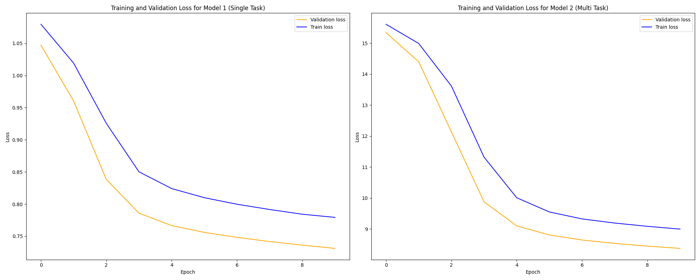

and to check evaluation, do these commands:
-> For the first model on Number task:

```shell
python pstal/tp1/sequoia/bin/accuracy.py --tagcolumn feats --pred pstal/tp3/predictions_number.conllu --gold pstal/tp1/sequoia/src/sequoia-ud.parseme.frsemcor.test --tagcolumn feats
```

-> For the second model on multitasks:

```shell
python pstal/tp1/sequoia/bin/accuracy.py --tagcolumn feats --pred pstal/tp3/predictions_multitask.conllu --gold pstal/tp1/sequoia/src/sequoia-ud.parseme.frsemcor.test --tagcolumn feats
```

# TP4: Supersense Tagger with Pre-trained Transformers

The objective of this lab work is to develop and evaluate a system capable of predicting semantic labels <br>
called super-senses (column frsemcor:noun). These labels indicate, for each noun, its coarse-grained semantic category. <br>
For example: surprise is a feeling (label: Feeling), leg is a body part (Body), lawyer is a person (Person) <br>
or a food item (Food) depending on the context, etc. We will use contextual vector representations, known as contextual <br>
embeddings, derived from pre-trained transformer models. <br>

To run model using CamemBERT pre-trained model:

```shell
python pstal/tp4/demo_without_extension.py --pre_trained_model CamemBERT
```

You should obtains this kind of loss:

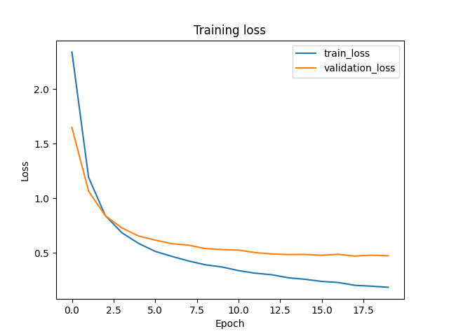

Extract process time: 111s Training process time: 3.4s All process time: 114<s

and to check evaluation, do this command:
```shell
python pstal/tp1/sequoia/bin/accuracy.py --tagcolumn frsemcor:noun --pred pstal/tp4/prediction/prediction_Camembert.conllu --gold lib/corpus/sequoia-ud.parseme.frsemcor.simple.test 
```
You should find 97.71 ( 9378/ 9598). 
And if you want to filter juste NOUN PROPN and NUM, run this command:

```shell
python pstal/tp1/sequoia/bin/accuracy.py --tagcolumn frsemcor:noun --pred pstal/tp4/prediction/prediction_Camembert.conllu --gold lib/corpus/sequoia-ud.parseme.frsemcor.simple.test --upos-filter NOUN PROPN NUM
```
You should find  91.28 ( 2512/ 2752)

To run model using Multi-BERT pre-trained model:

```shell
python pstal/tp4/demo_without_extension.py --pre_trained_model Multi-BERT
```

You should obtains this kind of loss:


Extract process time: 111s Training process time: 3.47s All process time: 115.43s

and to check evaluation, do this command:
```shell
python pstal/tp1/sequoia/bin/accuracy.py --tagcolumn frsemcor:noun --pred pstal/tp4/prediction/prediction_Multi-BERT.conllu --gold lib/corpus/sequoia-ud.parseme.frsemcor.simple.test 
```
You should find 95.75 ( 9190/ 9598). 
And if you want to filter juste NOUN PROPN and NUM, run this command:

```shell
python pstal/tp1/sequoia/bin/accuracy.py --tagcolumn frsemcor:noun --pred pstal/tp4/prediction/prediction_Multi-BERT.conllu --gold lib/corpus/sequoia-ud.parseme.frsemcor.simple.test --upos-filter NOUN PROPN NUM
```
You should find  85.17 ( 2344/ 2752)

To run model using Distilbert pre-trained model:

```shell
python pstal/tp4/demo_without_extension.py --pre_trained_model Distilbert
```

You should obtains this kind of loss:

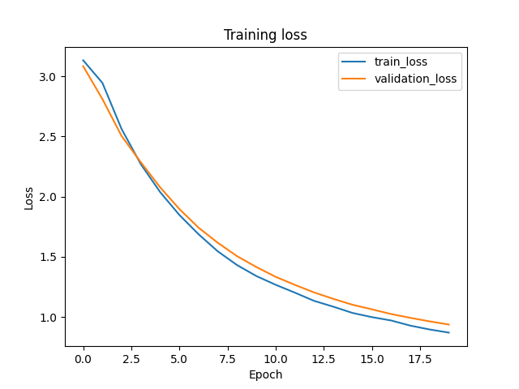

Extract process time: 60.69s Training process time: 3.49s All process time: 64.18s

and to check evaluation, do this command:
```shell
python pstal/tp1/sequoia/bin/accuracy.py --tagcolumn frsemcor:noun --pred pstal/tp4/prediction/prediction_Distilbert.conllu --gold lib/corpus/sequoia-ud.parseme.frsemcor.simple.test 
```
You should find 94.75 ( 9094/ 9598). 
And if you want to filter juste NOUN PROPN and NUM, run this command:

```shell
python pstal/tp1/sequoia/bin/accuracy.py --tagcolumn frsemcor:noun --pred pstal/tp4/prediction/prediction_Distilbert.conllu --gold lib/corpus/sequoia-ud.parseme.frsemcor.simple.test --upos-filter NOUN PROPN NUM
```
You should find  81.69 ( 2248/ 2752)

You should obtains this kind of loss:

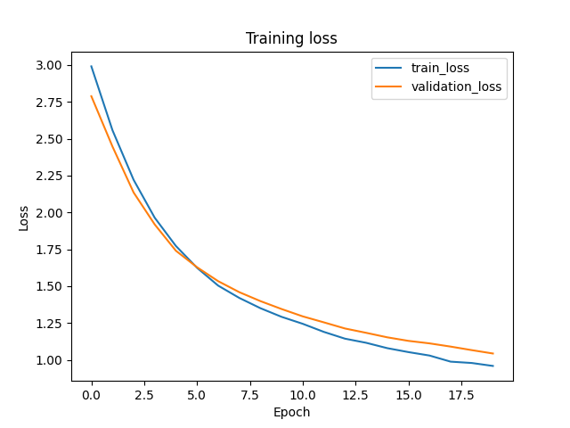

Extract process time: 58s Training process time: 3.39s All process time: 62.15s

To run model using extension on CamemBERT pre-trained model:

```shell
python pstal/tp4/demo_with_extension.py --pre_trained_model CamemBERT
```
You should find this kind of loss: <br>

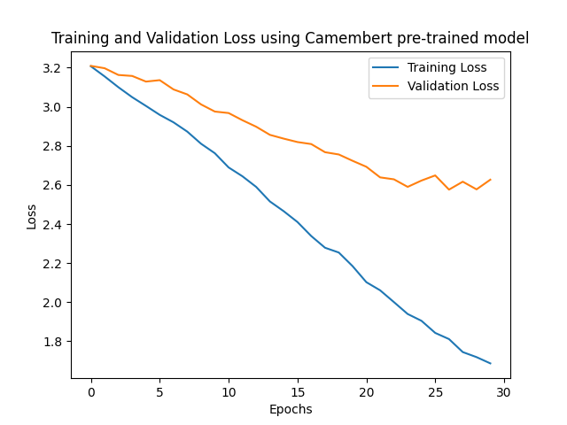

Extract process time: 1.45 Training process time: 331.41s All process time: 332.86s

and to check evaluation, do this command:
```shell
python pstal/tp1/sequoia/bin/accuracy.py --tagcolumn frsemcor:noun --pred pstal/tp4/prediction/prediction_ft_Camembert.conllu --gold lib/corpus/sequoia-ud.parseme.frsemcor.simple.test 
```
You should find 91.49 ( 8781/ 9598). 
And if you want to filter juste NOUN PROPN and NUM, run this command:

```shell
python pstal/tp1/sequoia/bin/accuracy.py --tagcolumn frsemcor:noun --pred pstal/tp4/prediction/prediction_ft_Camembert.conllu --gold lib/corpus/sequoia-ud.parseme.frsemcor.simple.test --upos-filter NOUN PROPN NUM
```
You should find  70.31 ( 1935/ 2752)

To run model using extension on Multi-BERT pre-trained model:

```shell
python pstal/tp4/demo_with_extension.py --pre_trained_model Multi-BERT
```

You sould find this kind of loss: <br>

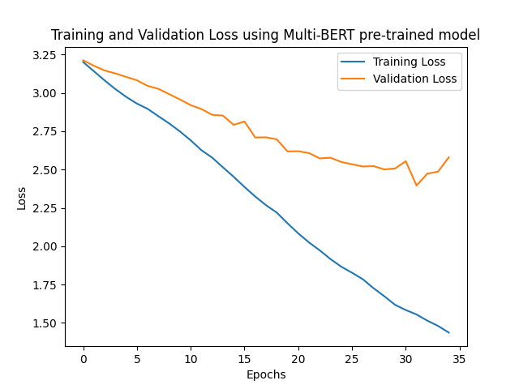

Extract process time: 1.32 Training process time: 275.74s All process time: 277.07s

and to check evaluation, do this command:
```shell
python pstal/tp1/sequoia/bin/accuracy.py --tagcolumn frsemcor:noun --pred pstal/tp4/prediction/prediction_ft_Multi-BERT.conllu --gold lib/corpus/sequoia-ud.parseme.frsemcor.simple.test 
```
You should find 91.66 ( 8798/ 9598). 
And if you want to filter juste NOUN PROPN and NUM, run this command:

```shell
python pstal/tp1/sequoia/bin/accuracy.py --tagcolumn frsemcor:noun --pred pstal/tp4/prediction/prediction_ft_Multi-BERT.conllu --gold lib/corpus/sequoia-ud.parseme.frsemcor.simple.test --upos-filter NOUN PROPN NUM
```
You should find  70.93 ( 1952/ 2752)

To run model using extension on Distilbert pre-trained model:

```shell
python pstal/tp4/demo_with_extension.py --pre_trained_model Distilbert
```

You sould find this kind of loss: <br>

Extract process time: 1.48 Training process time: 68.72 s All process time: 70.20 s

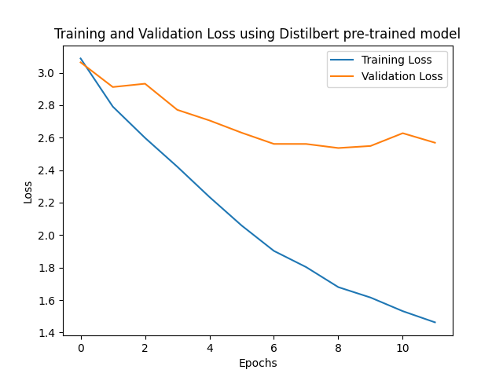

and to check evaluation, do this command:
```shell
python pstal/tp1/sequoia/bin/accuracy.py --tagcolumn frsemcor:noun --pred pstal/tp4/prediction/prediction_ft_Distilbert.conllu --gold lib/corpus/sequoia-ud.parseme.frsemcor.simple.test 
```
You should find 90.66 ( 8702/ 9598). 
And if you want to filter juste NOUN PROPN and NUM, run this command:

```shell
python pstal/tp1/sequoia/bin/accuracy.py --tagcolumn frsemcor:noun --pred pstal/tp4/prediction/prediction_ft_Distilbert.conllu --gold lib/corpus/sequoia-ud.parseme.frsemcor.simple.test --upos-filter NOUN PROPN NUM
```
You should find  67.44 ( 1856/ 2752)

```shell
python pstal/tp4/demo_various_k.py --pre_trained_model CamemBERT --k_min 1 --k_max 4
```

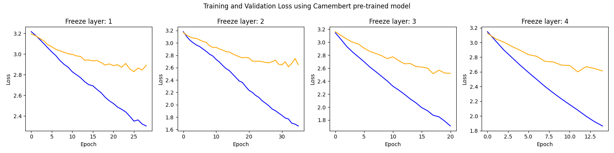

Evaluation score: <br>
- Global Accuracy: 86.74 / 90.23 / 90.69 / 90.93
- Filter Accuracy: 53.74 / 65.92 / 67.51 / 68.02

```shell
python pstal/tp4/demo_various_k.py --pre_trained_model Distilbert --k_min 1 --k_max 4
```

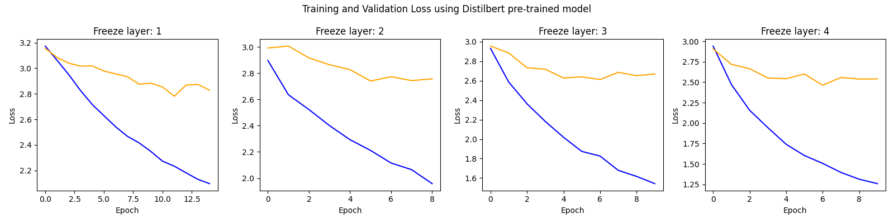

Evaluation score: <br>
- Global Accuracy: 87.12 / 89.19 / 90.55 / 91.25 
- Filter Accuracy: 55.09 / 62.28 / 67.04 / 69.48

```shell
python pstal/tp4/demo_various_k.py --pre_trained_model Multi-BERT --k_min 1 --k_max 4
```

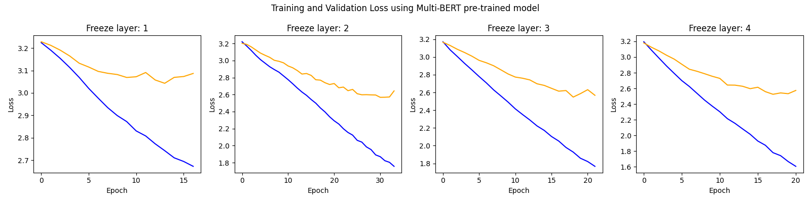

Evaluation score: <br>
- Global Accuracy: 83.19 / 90.22 / 90.96 / 91.39
- Filter Accuracy: 41.39 / 65.88 / 68.46 / 69.99

## Authors
- Marius THORRE
- Dang Dinh NGUYEN


